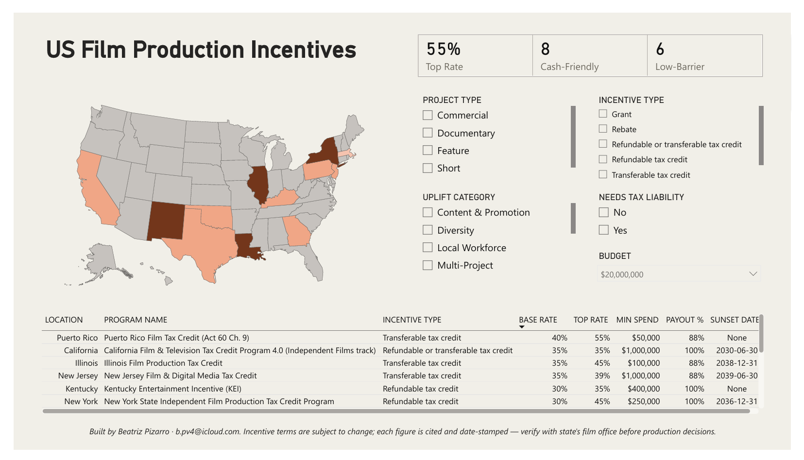
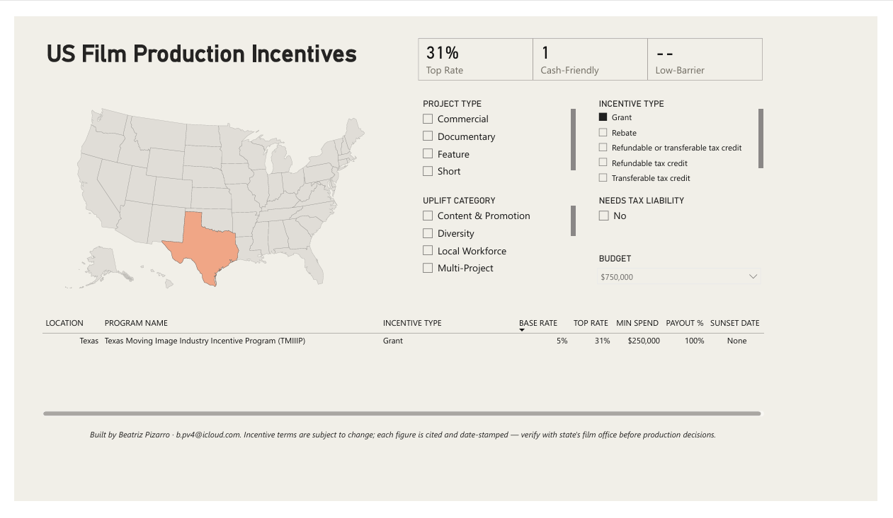
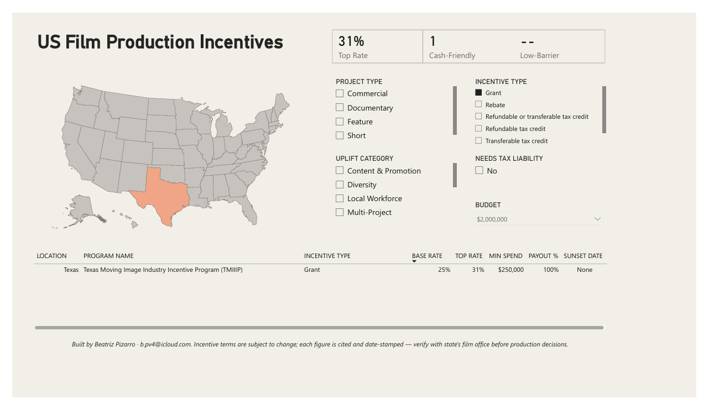
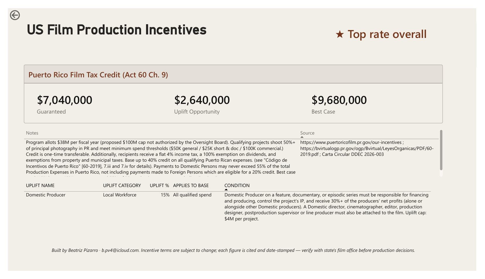
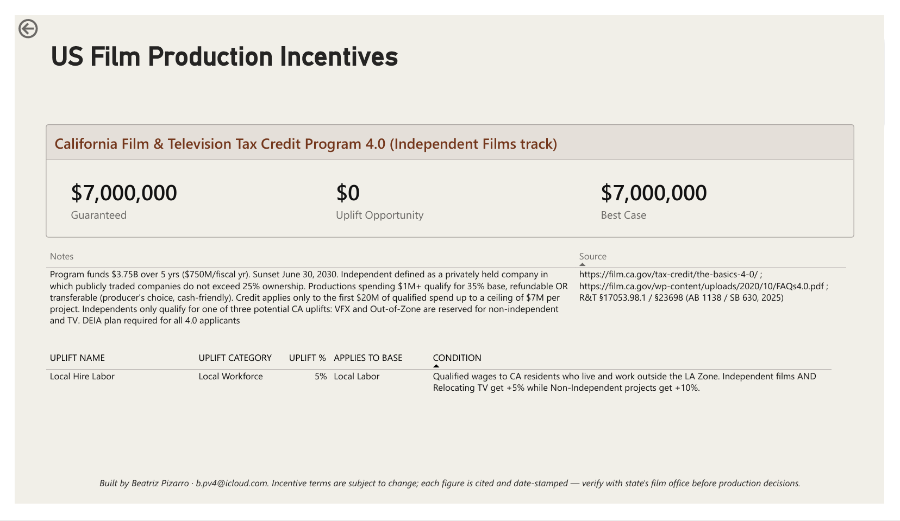
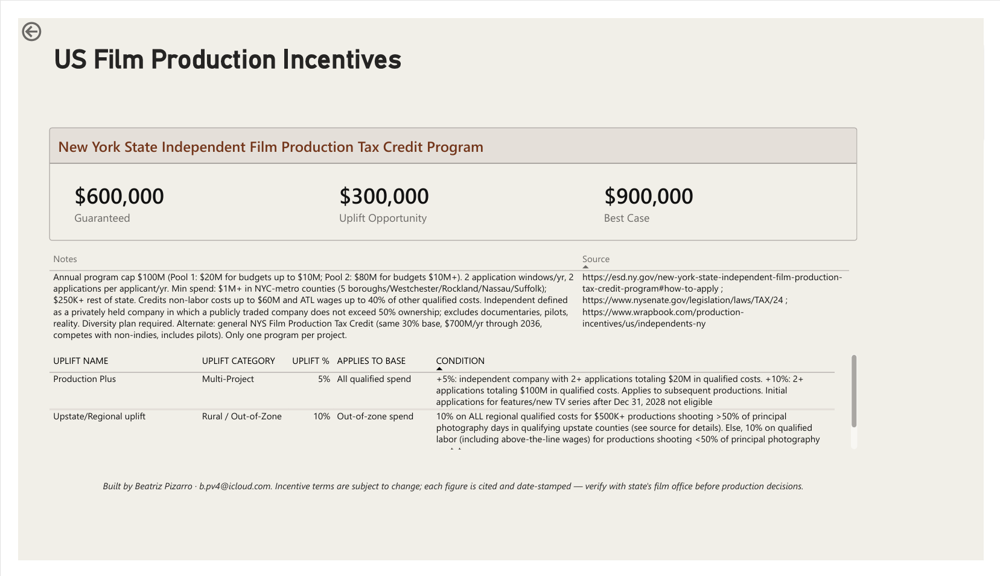

# US Film Production Incentives Dashboard

An interactive Power BI tool designed with independent producers in mind. Find the state where a film budget goes furthest and surface the rules behind each number.

Features a star-schema data model hand-verified against primary statutes. Built with Power BI, DAX, and Power Query.

---

## Overview

US states recognize the value that comes from the entertainment industry – jobs, training, local business, cultural promotion, and more. This project case studies 13 states and their individual approach to incentivizing entertainment initiatives – through tax credits, grants and rebates, minimum spends, detailed qualified spends, uplifts, and more. For an independent producer deciding where to shoot, the headlines ("up to 40%") rarely match what a given project would actually receive.

This dashboard works with the nuance. Set your budget and project parameters to determine eligibility across 13 programs and the effective credit your production would likely earn. Drill into any state to see the exact mechanics, caps, and statutory sources behind each figure.

---

## Key Features

- **What-if budget parameter:** a slider that recalculates each program's effective credit as you change the budget, stepping budget-scaled programs like Texas through their spend tiers.
- **Dynamic spend-tier logic:** Texas's grant rate scales with total qualifying spend (5% → 10% → 25%). The model reads the correct tier for any budget, exactly as the statute prescribes.
- **Project-type eligibility:** minimum-spend thresholds vary by type, so qualification updates with the project-type slicer. A $25K documentary qualifies in Puerto Rico; a $25K feature doesn't.
- **"Best value" flag:** a star marking the program with the highest effective rate across all 13 (currently Puerto Rico). It's a global comparison, a top-of-market marker.
- **Low-barrier filter:** surfaces programs an under-$100K indie can realistically access.
- **Incentive-type clarity:** refundable vs. transferable vs. rebate vs. grant vs. state buyback, each with a cash-value factor so a transferable credit isn't compared to cash at face value. (Transferable credits are typically sold to a third party with state tax liability at roughly 88¢ on the dollar.)
- **Uplift transparency:** every stackable bonus (local hire, rural, post-production, scoring, diversity, heritage, etc.) with its condition and source.

---

## Screenshots

### The landscape at a glance
*All 13 programs at a $2M budget.*



### A dynamic model, not a static chart
*Texas stepping through its grant tiers as the budget changes.*




### State deep-dives
*A program's full detail page: rates, uplifts, caps, and sources.*





*Additional captures for Georgia, New Mexico, Louisiana, and Texas.*

---

## Data Model

A **star schema** built for clean filter propagation and drill-through:

| Table | Role | Grain |
|---|---|---|
| `incentives` | Core dimension | One row per state program (13) |
| `uplifts` | Related detail | One row per stackable bonus (37) |
| `rate_tiers` | Spend-tier lookup | Texas grant tiers |
| `program_project_types` | Eligibility matrix | 13 states × 5 project types |
| `uplift_categories` / `spend_bases` | Lookups | Category & qualifying-base definitions |
| `Budget` | What-if parameter | Drives all budget-sensitive measures |
| `_Measures` | Measure table | Central home for DAX |

Drill-through passes the full program row to a detail page, so one click on a state (from either the program table or the map) opens its complete profile.

---

## Methodology: the "Best Case" framework

To compare programs fairly, each state's headline rate is calculated under a consistent rule set:

1. **If the statute states a headline cap, that cap wins.** (A program advertising "up to 55%" is modeled at 55% when all qualifying conditions are met.)
2. **Otherwise: base rate + every uplift that applies to the *whole* budget.** Uplifts tied to a narrow cost category (local-resident labor, VFX, scoring) are *excluded* from the best-case rate, because they reach only a slice of spend. **Exceptionally,** an uplift that could realistically cover the entire budget is counted. Case in point, New York's upstate bonus applies to all qualified spend when a production shoots entirely upstate. Plausible move for an indie, so we applied it to the full budget. All available uplifts appear on the state's detail page, regardless of AQS qualification.

This keeps the comparison honest: no state gets credit for a bonus a typical production couldn't realize across its entire budget.

---

## Notable DAX

**Tier-aware base rate:** reads the correct spend tier for budget-scaled programs, falling back to the flat base rate for everyone else:

```dax
Effective Base Rate =
VAR b   = [Budget Value]
VAR loc = SELECTEDVALUE( incentives[location] )
VAR tierRate =
    CALCULATE( MAX( rate_tiers[base_rate] ),
        rate_tiers[location] = loc,
        rate_tiers[tier_min_spend] <= b,
        rate_tiers[tier_max_spend] >  b )
RETURN IF( NOT ISBLANK( tierRate ), tierRate, SELECTEDVALUE( incentives[base_rate_pct] ) )
```

**Effective rate:** base plus whole-budget uplifts, capped at the program's legal maximum:

```dax
Effective Rate =
MIN( [Effective Base Rate] + [Whole-Budget Uplift %],
     SELECTEDVALUE( incentives[max_rate_pct] ) )
```

**Best-value flag:** flags the program whose effective rate equals the global maximum across all programs. `ALL(incentives)` strips filter and drill-through context, so it's a global "top of market" marker (currently Puerto Rico), not a per-slicer result:

```dax
Best Value Flag =
IF( [Effective Rate] = MAXX( ALL( incentives ), [Effective Rate] ),
    "★ Best value for your budget", "" )
```

---

## Data Sources

Each of the 13 programs was verified against **primary sources** including governing statutes and official state film-office program pages. A representative sample:

- **California:** R&T §17053.98.1 / §23698 (as amended by AB 1138 / SB 630, 2025); CA Film Commission 4.0 program page
- **New York:** NY Tax Law §24 & §24-D; ESD Independent Film Production Credit program
- **Louisiana:** RS 47:6007 as amended by Act 44 (2025); LED Entertainment
- **Texas:** SB 22 (2025 TMIIIP); Texas Film Commission grant rules
- **Puerto Rico:** Ley 60-2019 §1020.09; Carta Circular DDEC 2026-003
- **Illinois:** 35 ILCS 16 (Public Act 104-0453)
- **New Jersey:** N.J.S.A. 54:10A-5.39b; NJEDA

Each record carries its own `source` and `last_verified` date in the model.

---

## Tech Stack

- **Power BI Desktop:** modeling, DAX, report design
- **Power Query (M):** CSV ingestion, type handling, UTF-8 encoding
- **DAX:** what-if parameters, context transition, tier logic, best-value comparison measures
- **Data:** hand-curated CSV tables (star schema), verified against primary legal sources

---

## About

Built by **Beatriz Pizarro**, a multilingual cultural producer and data analyst with a background in filmmaking, casting, and arts programming (LACMA). Trained in Power BI through the Per Scholas AI/BI program.

📍 Brooklyn, NY · 🎬 Film & data · 🌐 EN / ES / FR

---

*Figures reflect program rules as verified in October 2026. Incentive programs change frequently, so always confirm current terms with the relevant state film office before making production decisions.*
